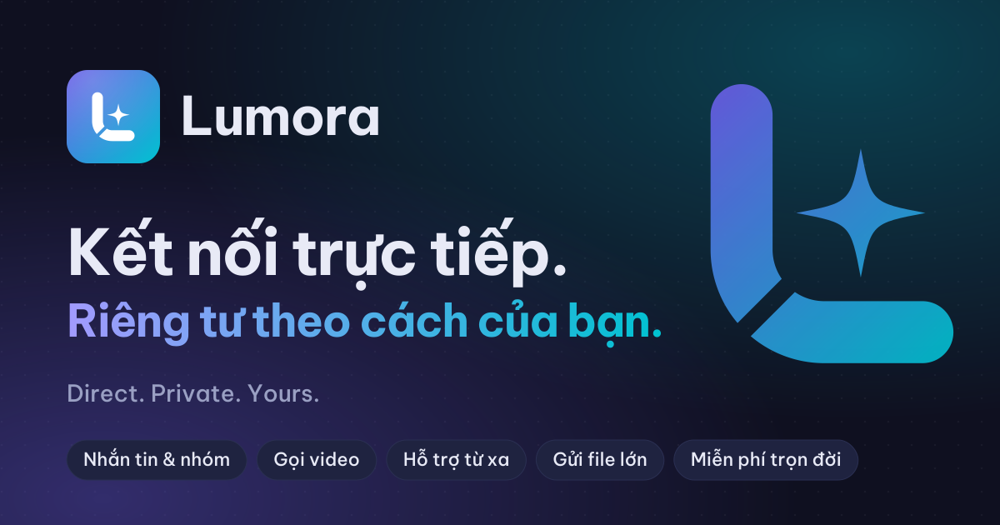
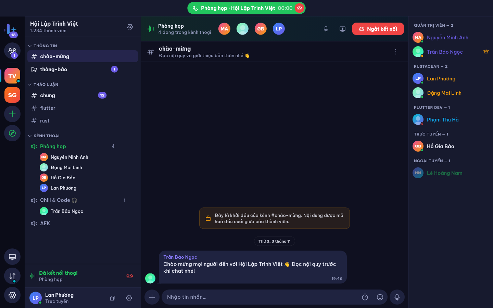
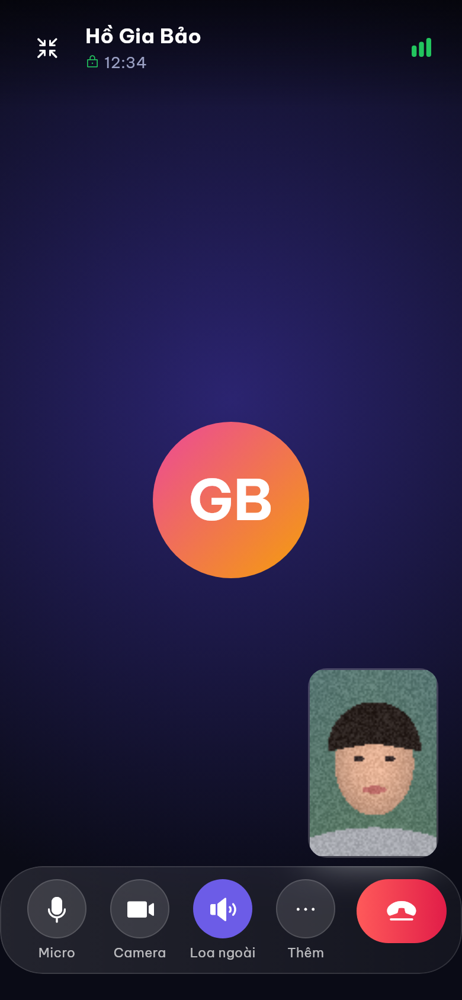
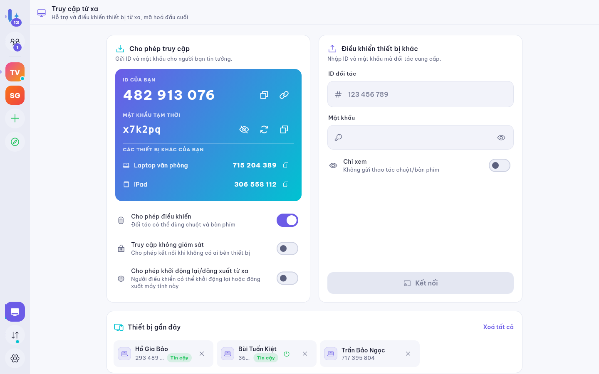

<div align="center">



<br>

[](https://github.com/hoangtuvungcao/get_lumora/releases/latest)
[](https://github.com/hoangtuvungcao/get_lumora/releases)


**[Trang chủ · Website](https://getlumora.pages.dev)** &nbsp;•&nbsp;
**[Tải về · Download](https://github.com/hoangtuvungcao/get_lumora/releases/latest)** &nbsp;•&nbsp;
**[Nhà phát triển · Developers](https://getlumora.pages.dev/developers/)** &nbsp;•&nbsp;
**[Mã ứng dụng/lõi · App/core source](https://github.com/hoangtuvungcao/lumora)** &nbsp;•&nbsp;
**[Cộng đồng · Community](https://getlumora.pages.dev/community/)** &nbsp;•&nbsp;
**[Tiếng Việt](#tiếng-việt)** &nbsp;•&nbsp;
**[English](#english)**

<br>


&nbsp;


</div>

---

## Tiếng Việt

**Lumora** là ứng dụng nhắn tin, gọi thoại và video, gửi tệp, cộng đồng và hỗ trợ máy tính từ xa — tất cả trong một.
Ứng dụng ưu tiên **kết nối P2P**, có thể dùng relay và thư ngoại tuyến đã mã hoá.
Không cần số điện thoại/email; bản hiện tại miễn phí và không quảng cáo. Mã hoá không che mọi metadata:
xem [chính sách và giới hạn](https://getlumora.pages.dev/privacy/).

- [Tính năng](#tính-năng)
- [Tải về](#tải-về)
- [Cài đặt](#cài-đặt)
- [Bắt đầu sử dụng](#bắt-đầu-sử-dụng)
- [Lumora hoạt động thế nào](#lumora-hoạt-động-thế-nào)
- [Quyền riêng tư và bảo mật](#quyền-riêng-tư-và-bảo-mật)
- [Câu hỏi thường gặp](#câu-hỏi-thường-gặp)
- [Dành cho nhà phát triển bot](#dành-cho-nhà-phát-triển-bot)
- [Kiểm tra tệp tải về](#kiểm-tra-tệp-tải-về)
- [Hỗ trợ và góp ý](#hỗ-trợ-và-góp-ý)

### Tính năng

| | |
|---|---|
| **Nhắn tin** | Chat riêng và nhóm, trả lời, chỉnh sửa, thu hồi hai chiều, ghim, bày tỏ cảm xúc, nhãn dán, bình chọn, danh sách việc, nhắc hẹn, vị trí (cả vị trí trực tiếp), tin tự huỷ, tin nhắn đã lưu, khoá từng cuộc trò chuyện |
| **Ảnh, video, tệp** | Chụp ảnh và quay video ngay trong chat, chỉnh ảnh trước khi gửi, tệp không giới hạn dung lượng, tải tiếp khi mạng chập chờn, tự tải theo Wi-Fi / dữ liệu di động |
| **Gọi thoại và video** | Gọi 1–1 và gọi nhóm, chia sẻ màn hình, hiệu ứng camera, cửa sổ video nổi, hình-trong-hình trên Android |
| **Cộng đồng** | Kênh chữ và phòng thoại, vai trò và quyền chi tiết, kênh chỉ thông báo, duyệt thành viên mới, liên kết mời thu hồi được |
| **Khoảnh khắc** | Ảnh và chữ 24 giờ, chọn người xem, danh sách bạn thân |
| **Truy cập từ xa** | Xem và điều khiển máy tính hoặc điện thoại của người thân bằng ID + mật khẩu — luôn cần người đó đồng ý |
| **Nhiều thiết bị** | Một tài khoản trên điện thoại, máy tính bảng và máy tính; lịch sử, cài đặt, nhãn dán được đồng bộ |
| **Bot** | Tạo bot trong **Xưởng Bot**, chạy bằng Python hoặc JavaScript, thêm vào nhóm |
| **Mạng khó** | Ảnh và tệp nhỏ vẫn tới khi hai máy không nối thẳng được (mạng 4G, NAT khó); cuộc gọi đi qua mạch hai chặng do người dùng tình nguyện chuyển tiếp — mỗi bên chỉ thấy một đầu |
| **Bảo mật** | Double Ratchet cho tin nhắn 1–1, cơ sở dữ liệu SQLCipher, khoá PIN, khôi phục bằng cụm 24 từ; tệp tải/xuất nằm ngoài mã hoá cơ sở dữ liệu |

<div align="center">

</div>

### Tải về

Mọi tệp nằm trong mục **[Releases](https://github.com/hoangtuvungcao/get_lumora/releases/latest)**
(`…` là số phiên bản, ví dụ `v1.0.10`).

| Thiết bị | Yêu cầu | Tệp nên tải |
|---|---|---|
| **Windows** | Windows 10 / 11, 64-bit | `Lumora-…-windows-x86_64-setup.exe` (bản cài đặt) hoặc `…-portable.zip` (không cần cài) |
| **macOS** | macOS 11 trở lên, Intel và Apple Silicon | `Lumora-…-macos-universal.dmg` |
| **Linux** | x86_64, glibc 2.39+ (Ubuntu 24.04, Debian 13, Fedora 40 trở lên) | `.deb` cho Ubuntu/Debian, `.AppImage` cho bản khác, hoặc `.tar.gz` |
| **Android** | Android 8.0 trở lên | `Lumora-…-android-universal.apk` — **khuyên dùng**, cài được trên mọi máy. Bản nhẹ hơn: `…-arm64-v8a.apk` (máy 64-bit đời mới), `…-armeabi-v7a.apk` (máy 32-bit đời cũ), `…-x86_64.apk` (chip Intel, máy ảo) |
| **iPhone / iPad** | iOS 14 trở lên | `Lumora-…-ios-unsigned.ipa` — cài thủ công (xem bên dưới) |
| **Chạy bot** | Windows / macOS / Linux | `Lumora-bot-runner-…` (xem [Dành cho nhà phát triển bot](#dành-cho-nhà-phát-triển-bot)) |

Bản hiện có: **v1.0.10**, phát hành **09/11/2026**, **18 tệp**. Cập nhật website không dựng lại ứng dụng.
Trước khi cập nhật ứng dụng, hãy sao lưu dữ liệu, kiểm tra chữ ký/ghi chú; không gỡ ứng dụng khi chưa sao lưu.

### Cài đặt

<details>
<summary><b>Windows</b></summary>

Chạy `…-setup.exe` và làm theo hướng dẫn. Nếu Windows SmartScreen cảnh báo, chọn **Thông tin thêm › Vẫn chạy**
(bản cài đặt chưa mua chứng chỉ ký số nên Windows chưa nhận diện). Cài im lặng cho nhiều máy:
`…-setup.exe /VERYSILENT /SUPPRESSMSGBOXES`. Bản `portable.zip`: giải nén rồi mở `lumora.exe`.
</details>

<details>
<summary><b>macOS</b></summary>

Mở tệp `.dmg`, kéo **Lumora** vào **Applications**. Bản chưa được Apple ký, nên lần đầu mở có thể bị chặn:
vào **Cài đặt hệ thống › Quyền riêng tư và Bảo mật** và chọn **Vẫn mở**.
</details>

<details>
<summary><b>Linux</b></summary>

```bash
sudo apt install ./Lumora-*-linux-amd64.deb                     # Ubuntu / Debian
chmod +x Lumora-*-linux-x86_64.AppImage && ./Lumora-*-linux-x86_64.AppImage   # bản phân phối khác
```

Trên Wayland, chia sẻ màn hình và điều khiển từ xa dùng cổng màn hình của hệ thống (PipeWire); hệ thống sẽ hỏi bạn cho phép.
</details>

<details>
<summary><b>Android</b></summary>

Tải `…-android-universal.apk` về điện thoại và mở nó. Khi được hỏi, cho phép **Cài ứng dụng không rõ nguồn gốc**
cho trình duyệt hoặc trình quản lý tệp. Nếu bản nhẹ báo *“gói có vẻ không hợp lệ”*, hãy cài bản universal.

Lần đầu mở, Lumora hỏi các quyền cần thiết ngay trong ứng dụng (thông báo, chạy nền, cuộc gọi khi máy khoá,
và trên máy Xiaomi / Redmi / POCO: cửa sổ bật lên cho bong bóng chat). Mỗi mục có một nút **Cấp quyền** mở thẳng đúng chỗ.
</details>

<details>
<summary><b>iPhone / iPad</b></summary>

Bản `.ipa` chưa được ký, cài bằng **AltStore** hoặc **Sideloadly** với Apple ID của bạn.
Apple ID miễn phí cần ký lại mỗi 7 ngày (các công cụ trên làm việc này tự động khi máy tính đang bật).
</details>

### Bắt đầu sử dụng

1. Mở Lumora, đặt tên và ảnh đại diện. Không cần số điện thoại hay email.
2. **Ghi lại cụm 24 từ** khôi phục ở nơi an toàn — đó là cách duy nhất lấy lại tài khoản khi mất máy.
3. Kết bạn bằng **ID 9 số**, **@tên**, mã QR hoặc liên kết mời. Lumora gửi lời mời kết bạn; khi người kia đồng ý, hai bạn trò chuyện được.
4. Dùng thêm máy khác: **Cài đặt › Thiết bị › Liên kết thiết bị mới**, quét mã QR bằng máy đang dùng.

Hướng dẫn đầy đủ: [getlumora.pages.dev](https://getlumora.pages.dev).

### Lumora hoạt động thế nào

Lumora ưu tiên mạng **ngang hàng (P2P)**, với kết nối nội dung mã hoá, relay và thư ngoại tuyến khi cần.
Lumora tìm đường theo thứ tự:

1. **Cùng mạng nội bộ** (Wi-Fi nhà, văn phòng) — nhanh nhất.
2. **Nối thẳng qua Internet** — IPv6 hoặc đục lỗ NAT trên IPv4.
3. **Bạn bè chung làm cầu nối** khi hai máy không nối thẳng được ("Giúp bạn bè kết nối").
4. **Mạch hai chặng qua người tình nguyện** ("Giúp mạng Lumora", bật sẵn trên máy tính): dữ liệu đã mã hoá đi qua hai thiết bị,
   giới hạn thông tin mỗi chặng thấy nhưng không bảo đảm ẩn danh trước metadata, thông đồng hoặc thiết bị bị xâm nhập.
5. **Hộp thư mã hoá** khi không có đường nào: tin nhắn, ảnh và tệp đến 8 MB vẫn tới, chậm hơn một chút.

Lịch sử chính nằm trên thiết bị. Bạn bè, relay và Nostr có thể giữ bản mã thư ngoại tuyến;
đây không phải cam kết không lưu trên máy chủ. Relay thấy metadata; một số relay Nostr có thể
liên kết ID–IP khi bật tìm theo ID.

### Quyền riêng tư và bảo mật

- Không tài khoản trên máy chủ, không số điện thoại, không email.
- Tin nhắn 1–1 dùng Double Ratchet; nhóm dùng khoá nhóm luân phiên. Người nhận và bot đọc được nội dung gửi cho họ.
- SQLCipher bảo vệ lịch sử/danh bạ; ảnh, video và tệp tải/xuất ra là tệp thông thường ngoài SQLCipher.
- Bên kết nối trực tiếp, bot, các bên liên quan trong nhóm và hạ tầng có thể thấy IP. Relay được cấu hình thấy danh tính và IP; không cam kết ẩn danh IP hoàn toàn.
- Bạn chọn ai được gọi cho bạn, ai được thêm bạn vào nhóm, ai thấy bạn đang trực tuyến.
- Không quảng cáo, không thu thập dữ liệu để bán.

**Báo lỗ hổng bảo mật:** vui lòng gửi riêng tới **trong20843@gmail.com** (đừng tạo Issue công khai).

### Câu hỏi thường gặp

<details>
<summary><b>Ảnh gửi đi hiện "Chờ đối phương nhận" rất lâu?</b></summary>

Người nhận đang ngoại tuyến hoặc hai máy chưa có đường nối. Ảnh và tệp đến 8 MB sẽ đi qua hộp thư mã hoá ngay khi
người nhận mở Lumora (cả hai cần bản 1.0.9 trở lên). Tệp lớn hơn tự gửi tiếp khi hai máy nối được với nhau, từ chỗ đã dừng.
</details>

<details>
<summary><b>Gọi không nối được khi cả hai dùng 4G?</b></summary>

Mạng di động thường dùng NAT khó, hai máy không nối thẳng được. Lumora sẽ dùng mạch hai chặng qua người tình nguyện
nếu có. Bật **Cài đặt › Quyền riêng tư › Kết nối › Giúp mạng Lumora** trên máy tính ở mạng tốt để giúp mọi người. Một trong hai bên
dùng Wi-Fi nhà (đặc biệt khi có IPv6) cũng giúp nối thẳng được.
</details>

<details>
<summary><b>Máy Xiaomi / Redmi / POCO: bong bóng chat trống, cuộc gọi không đổ chuông khi khoá máy?</b></summary>

HyperOS / MIUI chặn sẵn một số quyền. Vào **Cài đặt › Thông báo › Chạy nền ổn định** và bấm
**Cấp quyền** ở từng mục (cửa sổ bật lên khi chạy nền, hiển thị trên ứng dụng khác, hiển thị trên màn hình khoá,
thông báo toàn màn hình, tự khởi chạy).
</details>

<details>
<summary><b>Không nhận được tin khi đã tắt ứng dụng?</b></summary>

Thông báo khi đóng ứng dụng phụ thuộc nền tảng, quyền chạy nền và cấu hình push. Cho phép **Không giới hạn pin** và **Tự khởi chạy**
(máy Xiaomi, OPPO, vivo, Huawei…) trong tờ hướng dẫn của ứng dụng.
</details>

<details>
<summary><b>Mất máy hoặc cài lại thì sao?</b></summary>

Cài Lumora trên máy mới, chọn **Khôi phục tài khoản** rồi nhập cụm 24 từ. Tài khoản quay lại; bạn bè có thể giúp gửi lại lịch sử chat
1–1 trong 6 tháng gần nhất và đưa bạn trở lại các nhóm (bạn duyệt từng người).
</details>

### Dành cho nhà phát triển bot

Bot là một tài khoản Lumora được điều khiển bằng mã của bạn, chạy qua **Lumora Bot Runner** — không cần thuê máy chủ.

1. Trong Lumora, mở **Xưởng Bot**, gửi `/newbot` và lấy **mã bí mật** (token).
2. Tải `Lumora-bot-runner-…` cho hệ điều hành của bạn trong [Releases](https://github.com/hoangtuvungcao/get_lumora/releases/latest).
3. Cài SDK và chạy:

```bash
pip install lumora-bot          # Python 3.8+
npm install lumora-bot          # Node.js 18+
```

```python
from lumora_bot import Bot

bot = Bot()                     # đọc token từ LUMORA_BOT_TOKEN

@bot.command("start", "Bắt đầu")
def start(ctx):
    ctx.reply("Xin chào! 👋")

bot.run()
```

Tài liệu đầy đủ (hướng dẫn, API, vận hành 24/7, API HTTP): **[getlumora.pages.dev/developers](https://getlumora.pages.dev/developers/)**.
SDK phát hành theo giấy phép MIT.

### Kiểm tra tệp tải về

Mỗi bản phát hành kèm `SHA256SUMS` và chữ ký `SHA256SUMS.sigstore.json` do quy trình build chính thức tạo ra.

```bash
sha256sum -c SHA256SUMS --ignore-missing          # macOS: shasum -a 256 -c SHA256SUMS --ignore-missing
```

Lệnh `cosign verify-blob` để kiểm tra chữ ký nằm trong ghi chú của từng bản phát hành.

### Hỗ trợ và góp ý

Gặp lỗi hoặc muốn đề xuất tính năng? Tạo một **[Issue](https://github.com/hoangtuvungcao/get_lumora/issues)**
và ghi rõ: hệ điều hành và phiên bản, phiên bản Lumora (**Cài đặt › Giới thiệu**), các bước để gặp lỗi, và ảnh chụp
màn hình nếu có. Liên hệ: **trong20843@gmail.com**.

---

## English

**Lumora** brings chat, voice and video calls, file sharing, communities and remote help together in one app.
The app prefers **P2P connections** and can use relays and sealed offline mail.
No phone number/email is required; the current release is free to use and has no ads.
Encryption does not hide all metadata: see the [policy and limits](https://getlumora.pages.dev/privacy/).

- [Features](#features)
- [Download](#download)
- [Installation](#installation)
- [Getting started](#getting-started)
- [How Lumora works](#how-lumora-works)
- [Privacy and security](#privacy-and-security)
- [FAQ](#faq)
- [For bot developers](#for-bot-developers)
- [Verify your download](#verify-your-download)
- [Support and feedback](#support-and-feedback)

### Features

| | |
|---|---|
| **Messaging** | Direct and group chats, replies, edit and delete for everyone, pins, reactions, stickers, polls, checklists, reminders, locations (including live location), disappearing messages, saved messages, per-chat lock |
| **Photos, videos, files** | Take photos and record videos right in the chat, edit photos before sending, files of any size, resumes over unstable networks, auto-download per Wi-Fi / mobile data |
| **Voice and video** | One-to-one and group calls, screen sharing, camera effects, floating video window, picture-in-picture on Android |
| **Communities** | Text channels and voice rooms, fine-grained roles and permissions, announcement-only channels, member approval, revocable invite links |
| **Moments** | 24-hour photo and text stories, choose who sees them, close friends |
| **Remote access** | View and control a relative's computer or phone with an ID and password — always with their consent |
| **Multiple devices** | One account on your phone, tablet and computer; history, settings and stickers kept in sync |
| **Bots** | Create bots in **Bot Studio**, run them in Python or JavaScript, add them to groups |
| **Hard networks** | Photos and small files still arrive when two devices can't connect directly (mobile data, strict NATs); calls go through a two-hop circuit relayed by volunteers — each sees only one end |
| **Security** | Double Ratchet for 1–1 messages, SQLCipher database, PIN lock, 24-word recovery; downloaded/exported files are outside database encryption |

### Download

Every file is on the **[Releases](https://github.com/hoangtuvungcao/get_lumora/releases/latest)** page
(`…` is the version, e.g. `v1.0.10`).

| Device | Requirements | Recommended file |
|---|---|---|
| **Windows** | Windows 10 / 11, 64-bit | `Lumora-…-windows-x86_64-setup.exe` (installer) or `…-portable.zip` (no install) |
| **macOS** | macOS 11 or later, Intel and Apple Silicon | `Lumora-…-macos-universal.dmg` |
| **Linux** | x86_64, glibc 2.39+ (Ubuntu 24.04, Debian 13, Fedora 40 or later) | `.deb` for Ubuntu/Debian, `.AppImage` for other distributions, or `.tar.gz` |
| **Android** | Android 8.0 or later | `Lumora-…-android-universal.apk` — **recommended**, installs on every device. Lighter builds: `…-arm64-v8a.apk` (recent 64-bit phones), `…-armeabi-v7a.apk` (older 32-bit phones), `…-x86_64.apk` (Intel chips, emulators) |
| **iPhone / iPad** | iOS 14 or later | `Lumora-…-ios-unsigned.ipa` — sideload (see below) |
| **Running bots** | Windows / macOS / Linux | `Lumora-bot-runner-…` (see [For bot developers](#for-bot-developers)) |

Current release: **v1.0.10**, published **9 November 2026**, with **18 assets**. Website updates do not rebuild the app.
Back up data and check signatures/release notes before updating; do not uninstall without a backup.

### Installation

<details>
<summary><b>Windows</b></summary>

Run `…-setup.exe` and follow the steps. If Windows SmartScreen warns you, choose **More info › Run anyway**
(the installer has no purchased code-signing certificate yet). Silent install for many machines:
`…-setup.exe /VERYSILENT /SUPPRESSMSGBOXES`. For the `portable.zip`: extract it and open `lumora.exe`.
</details>

<details>
<summary><b>macOS</b></summary>

Open the `.dmg` and drag **Lumora** into **Applications**. The build isn't notarized by Apple, so the first launch
may be blocked: go to **System Settings › Privacy & Security** and choose **Open Anyway**.
</details>

<details>
<summary><b>Linux</b></summary>

```bash
sudo apt install ./Lumora-*-linux-amd64.deb                     # Ubuntu / Debian
chmod +x Lumora-*-linux-x86_64.AppImage && ./Lumora-*-linux-x86_64.AppImage   # other distributions
```

On Wayland, screen sharing and remote control use the system's screen portal (PipeWire); the system asks for your permission.
</details>

<details>
<summary><b>Android</b></summary>

Download `…-android-universal.apk` to your phone and open it. When asked, allow **Install unknown apps**
for your browser or file manager. If a lighter build says *“package appears to be invalid”*, install the universal one.

On first launch Lumora asks for what it needs right inside the app (notifications, background use, calls on the lock
screen, and on Xiaomi / Redmi / POCO phones the pop-up permissions chat bubbles need). Each item has an **Allow**
button that opens the right place.
</details>

<details>
<summary><b>iPhone / iPad</b></summary>

The `.ipa` is unsigned: install it with **AltStore** or **Sideloadly** using your Apple ID.
A free Apple ID needs re-signing every 7 days (those tools do it automatically while your computer is on).
</details>

### Getting started

1. Open Lumora and pick a name and a picture. No phone number or email.
2. **Write down your 24-word recovery phrase** somewhere safe — it is the only way to get your account back if you lose your device.
3. Add friends by their **9-digit ID**, **@name**, a QR code or an invite link. Lumora sends a friend request; once they accept, you can talk.
4. Another device: **Settings › Devices › Link a new device**, then scan the QR code with the device you already use.

Full guide: [getlumora.pages.dev](https://getlumora.pages.dev).

### How Lumora works

Lumora prefers **peer-to-peer** networking, with encrypted content connections, relays and offline mail when needed.
Lumora looks for a path in this order:

1. **The same local network** (home or office Wi-Fi) — fastest.
2. **Directly over the Internet** — IPv6, or NAT hole punching on IPv4.
3. **A mutual friend as a bridge** when the two devices can't connect directly ("Help friends connect").
4. **A two-hop circuit through volunteers** ("Help the Lumora network", on by default on computers): encrypted data passes
   two devices, limiting per-hop visibility but not promising anonymity against metadata, collusion or compromised devices.
5. **The encrypted mailbox** when nothing else works: messages, photos and files up to 8 MB still arrive, a little slower.

Primary history lives on devices. Friends, relays and Nostr can retain offline-mail ciphertext.
This is not a no-server-storage promise. Relays see metadata; some Nostr relays can link ID–IP while ID discovery is enabled.

### Privacy and security

- No server account, no phone number, no email address.
- One-to-one messages use Double Ratchet; groups use rotating keys. Recipients and bots can read content sent to them.
- SQLCipher protects history/contact databases; downloads/exports are normal files outside SQLCipher.
- Direct peers, bots, permitted group peers and infrastructure can see IPs. Configured relays see identity and IP; complete IP anonymity is not promised.
- You choose who can call you, who can add you to groups and who sees you online.
- No ads, and no data collected to sell.

**Reporting a vulnerability:** please write privately to **trong20843@gmail.com** (don't open a public issue).

### FAQ

<details>
<summary><b>A photo I sent says "Waiting for recipient" for a long time?</b></summary>

The recipient is offline or the two devices have no path yet. Photos and files up to 8 MB go through the encrypted
mailbox as soon as the recipient opens Lumora (both need version 1.0.9 or newer). Bigger files continue once the two
devices can connect, from where they stopped.
</details>

<details>
<summary><b>Calls don't connect when both of us are on mobile data?</b></summary>

Mobile networks usually use strict NATs, so the two devices can't connect directly. Lumora then uses a two-hop circuit
through volunteers when available. Turn on **Settings › Privacy › Connectivity › Help the Lumora network** on a computer with a good
connection to help everyone. One side on home Wi-Fi (especially with IPv6) also helps connect directly.
</details>

<details>
<summary><b>Xiaomi / Redmi / POCO: empty chat bubbles, no ringing on the lock screen?</b></summary>

HyperOS / MIUI blocks some permissions by default. Go to **Settings › Notifications › Keep running in the background**
and tap **Allow** on each item (pop-ups while in the background, display over other apps, show on the lock
screen, full-screen notifications, autostart).
</details>

<details>
<summary><b>No messages while the app is closed?</b></summary>

Notifications while the app is closed depend on platform, background permissions and push configuration. Allow **Unrestricted battery** and **Autostart**
(Xiaomi, OPPO, vivo, Huawei…) from the app's guide.
</details>

<details>
<summary><b>Lost or reinstalled my device?</b></summary>

Install Lumora on the new device and choose **Restore account** and enter your 24 words. Your account comes back; friends can resend
the last 6 months of your 1-1 chats and bring you back into your groups (you review each offer).
</details>

### For bot developers

A bot is a Lumora account driven by your code through **Lumora Bot Runner** — no server to rent.

1. In Lumora, open **Bot Studio**, send `/newbot` and copy the **secret token**.
2. Download `Lumora-bot-runner-…` for your operating system from [Releases](https://github.com/hoangtuvungcao/get_lumora/releases/latest).
3. Install the SDK and run:

```bash
pip install lumora-bot          # Python 3.8+
npm install lumora-bot          # Node.js 18+
```

```python
from lumora_bot import Bot

bot = Bot()                     # reads the token from LUMORA_BOT_TOKEN

@bot.command("start", "Start")
def start(ctx):
    ctx.reply("Hello! 👋")

bot.run()
```

Full documentation (guides, API reference, running 24/7, HTTP API): **[getlumora.pages.dev/developers](https://getlumora.pages.dev/developers/)**.
The SDK is MIT-licensed.

### Verify your download

Every release includes `SHA256SUMS` and its signature `SHA256SUMS.sigstore.json`, produced by the official build workflow.

```bash
sha256sum -c SHA256SUMS --ignore-missing          # macOS: shasum -a 256 -c SHA256SUMS --ignore-missing
```

The `cosign verify-blob` command that checks the signature is in each release's notes.

### Support and feedback

Found a bug or have an idea? Open an **[Issue](https://github.com/hoangtuvungcao/get_lumora/issues)** and include
your operating system and its version, the Lumora version (**Settings › About**), the steps that lead to the problem,
and a screenshot if you can. Contact: **trong20843@gmail.com**.

---

<div align="center">

**Giấy phép · License** — Ứng dụng/lõi có giấy phép riêng · Lumora app/core are proprietary freeware:
[LICENSE.md](LICENSE.md) &nbsp;•&nbsp; SDK bot: MIT &nbsp;•&nbsp; Thành phần mã nguồn mở · Open-source components:
[THIRD_PARTY_NOTICES.md](THIRD_PARTY_NOTICES.md)

<sub>Kho này chứa bản phát hành và mã website; mã ứng dụng/lõi ở kho riêng, có thể tạm hạn chế khi bảo trì. Công khai mã không đồng nghĩa mã nguồn mở. · Releases and website source live here; app/core source is separate and may be restricted during maintenance. Source visibility is not an open-source license.</sub>

**[Website build/deploy documentation](docs/WEBSITE.md)** · **[Issues](https://github.com/hoangtuvungcao/get_lumora/issues)** · **[Discussions](https://github.com/hoangtuvungcao/get_lumora/discussions)**

</div>
