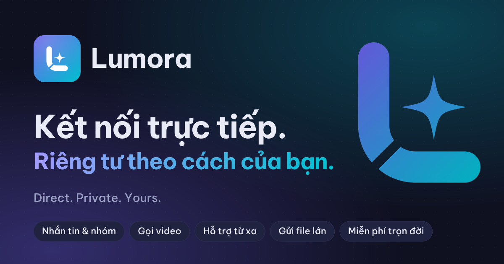

<div align="center">



<br>

[](https://github.com/hoangtuvungcao/get_lumora/releases/latest)
[](https://github.com/hoangtuvungcao/get_lumora/releases)


**[Trang chủ · Website](https://getlumora.pages.dev)** &nbsp;•&nbsp;
**[Tải về · Download](https://github.com/hoangtuvungcao/get_lumora/releases/latest)** &nbsp;•&nbsp;
**[Tiếng Việt](#tiếng-việt)** &nbsp;•&nbsp;
**[English](#english)**

</div>

---

## Tiếng Việt

**Lumora** là ứng dụng nhắn tin, gọi video, gửi file và hỗ trợ máy tính từ xa — tất cả trong một.
Bạn và người thân kết nối trực tiếp với nhau: không cần đăng ký, không cần số điện thoại, không quảng cáo
và hoàn toàn miễn phí. Chỉ bạn và người nhận đọc được tin nhắn.

### Tính năng

| | |
|---|---|
| **Nhắn tin** | Chat riêng, nhóm, kênh, sticker, tin 24 giờ, tin nhắn tự huỷ, ghim, trả lời, chỉnh sửa và thu hồi hai chiều |
| **Gọi thoại & video** | Gọi 1–1 và gọi nhóm, chia sẻ màn hình, hiệu ứng camera |
| **Gửi file** | Không giới hạn dung lượng, tiếp tục được khi mạng chập chờn |
| **Hỗ trợ từ xa** | Xem và điều khiển máy tính hoặc điện thoại của người thân — luôn cần người đó đồng ý |
| **Nhiều thiết bị** | Một tài khoản dùng trên điện thoại và máy tính, lịch sử được đồng bộ |
| **Bảo mật** | Mã hoá đầu cuối, dữ liệu trên máy được mã hoá, khoá ứng dụng bằng PIN, khôi phục bằng cụm 24 từ |

### Tải về

Tất cả tệp nằm trong mục **[Releases](https://github.com/hoangtuvungcao/get_lumora/releases/latest)**.

| Hệ điều hành | Yêu cầu | Tệp nên tải |
|---|---|---|
| **Windows** | Windows 10 / 11, 64-bit | `Lumora-…-windows-x86_64-setup.exe` (bản cài đặt) hoặc `…-portable.zip` (không cần cài) |
| **macOS** | macOS 11 trở lên, Intel & Apple Silicon | `Lumora-…-macos-universal.dmg` |
| **Linux** | x86_64, Ubuntu 24.04 / Debian 13 / Fedora 40 trở lên | `.deb` cho Ubuntu/Debian, `.AppImage` cho các bản khác, hoặc `.tar.gz` |
| **Android** | Android 8.0 trở lên | `Lumora-…-android-arm64-v8a.apk` cho hầu hết điện thoại — không chắc thì chọn `…-android-universal.apk` |

### Cài đặt

<details>
<summary><b>Windows</b></summary>

Chạy tệp `…-setup.exe` và làm theo hướng dẫn. Nếu Windows SmartScreen hiện cảnh báo, chọn
**Thông tin thêm › Vẫn chạy**. Với bản `portable.zip`: giải nén rồi mở `lumora.exe`.
</details>

<details>
<summary><b>macOS</b></summary>

Mở tệp `.dmg`, kéo **Lumora** vào thư mục **Applications**. Nếu lần đầu mở bị chặn, vào
**Cài đặt hệ thống › Quyền riêng tư & Bảo mật** và chọn **Vẫn mở**.
</details>

<details>
<summary><b>Linux</b></summary>

```bash
sudo apt install ./Lumora-v1.0.0-linux-amd64.deb          # Ubuntu / Debian
chmod +x Lumora-v1.0.0-linux-x86_64.AppImage && ./Lumora-v1.0.0-linux-x86_64.AppImage   # bản khác
```
</details>

<details>
<summary><b>Android</b></summary>

Tải tệp `.apk` về điện thoại và mở nó. Khi được hỏi, cho phép **Cài ứng dụng không rõ nguồn gốc**
cho trình duyệt hoặc trình quản lý tệp.
</details>

### Quyền riêng tư

- Không tài khoản trên máy chủ, không số điện thoại, không email.
- Tin nhắn, cuộc gọi và file được mã hoá đầu cuối; dữ liệu lưu trên máy cũng được mã hoá.
- Không quảng cáo, không thu thập dữ liệu để bán.
- Người lạ không thể biết địa chỉ mạng của bạn.

### Kiểm tra tệp tải về

Mỗi bản phát hành kèm `SHA256SUMS` và chữ ký `SHA256SUMS.sigstore.json` do quy trình build chính thức tạo ra.

```bash
sha256sum -c SHA256SUMS --ignore-missing          # macOS: shasum -a 256 -c SHA256SUMS --ignore-missing
```

Lệnh `cosign verify-blob` để kiểm tra chữ ký có trong ghi chú của từng bản phát hành.

### Hỗ trợ

Gặp lỗi hoặc muốn góp ý? Hãy tạo một **[Issue](https://github.com/hoangtuvungcao/get_lumora/issues)**.
Vui lòng ghi rõ hệ điều hành, phiên bản Lumora và các bước để gặp lỗi.

---

## English

**Lumora** brings chat, video calls, file sharing and remote help together in one app.
You connect directly with the people you know: no sign-up, no phone number, no ads, and free forever.
Only you and the people you talk to can read your messages.

### Features

| | |
|---|---|
| **Messaging** | Direct chats, groups, channels, stickers, 24-hour stories, disappearing messages, pins, replies, edit and delete for everyone |
| **Voice & video** | One-to-one and group calls, screen sharing, camera effects |
| **File sharing** | Files of any size, resumes over unstable networks |
| **Remote help** | View and control a relative's computer or phone — always with their consent |
| **Multiple devices** | One account on your phone and computer, with history kept in sync |
| **Security** | End-to-end encryption, encrypted storage, PIN app lock, recovery with a 24-word phrase |

### Download

Every file is on the **[Releases](https://github.com/hoangtuvungcao/get_lumora/releases/latest)** page.

| Platform | Requirements | Recommended file |
|---|---|---|
| **Windows** | Windows 10 / 11, 64-bit | `Lumora-…-windows-x86_64-setup.exe` (installer) or `…-portable.zip` (no install) |
| **macOS** | macOS 11 or later, Intel & Apple Silicon | `Lumora-…-macos-universal.dmg` |
| **Linux** | x86_64, Ubuntu 24.04 / Debian 13 / Fedora 40 or later | `.deb` for Ubuntu/Debian, `.AppImage` for other distributions, or `.tar.gz` |
| **Android** | Android 8.0 or later | `Lumora-…-android-arm64-v8a.apk` for most phones — if unsure, `…-android-universal.apk` |

### Installation

<details>
<summary><b>Windows</b></summary>

Run the `…-setup.exe` file and follow the steps. If Windows SmartScreen shows a warning, choose
**More info › Run anyway**. For the `portable.zip`: extract it and open `lumora.exe`.
</details>

<details>
<summary><b>macOS</b></summary>

Open the `.dmg` and drag **Lumora** into **Applications**. If macOS blocks the first launch, go to
**System Settings › Privacy & Security** and choose **Open Anyway**.
</details>

<details>
<summary><b>Linux</b></summary>

```bash
sudo apt install ./Lumora-v1.0.0-linux-amd64.deb          # Ubuntu / Debian
chmod +x Lumora-v1.0.0-linux-x86_64.AppImage && ./Lumora-v1.0.0-linux-x86_64.AppImage   # other distributions
```
</details>

<details>
<summary><b>Android</b></summary>

Download the `.apk` to your phone and open it. When asked, allow **Install unknown apps**
for your browser or file manager.
</details>

### Privacy

- No server account, no phone number, no email address.
- Messages, calls and files are end-to-end encrypted; data stored on your device is encrypted too.
- No ads, and no data collected to sell.
- Strangers cannot learn your network address.

### Verify your download

Every release includes `SHA256SUMS` and its signature `SHA256SUMS.sigstore.json`, produced by the official build workflow.

```bash
sha256sum -c SHA256SUMS --ignore-missing          # macOS: shasum -a 256 -c SHA256SUMS --ignore-missing
```

The `cosign verify-blob` command that checks the signature is in each release's notes.

### Support

Found a bug or have feedback? Please open an **[Issue](https://github.com/hoangtuvungcao/get_lumora/issues)**
and include your operating system, the Lumora version and the steps that lead to the problem.

---

<div align="center">

**Giấy phép · License** — Lumora là phần mềm miễn phí, mã nguồn đóng · Lumora is proprietary freeware:
[LICENSE.md](LICENSE.md) &nbsp;•&nbsp; Thành phần mã nguồn mở · Open-source components:
[THIRD_PARTY_NOTICES.md](THIRD_PARTY_NOTICES.md)

<sub>Kho này chỉ chứa bản cài đặt, không chứa mã nguồn. · This repository holds release binaries only, no source code.</sub>

</div>
